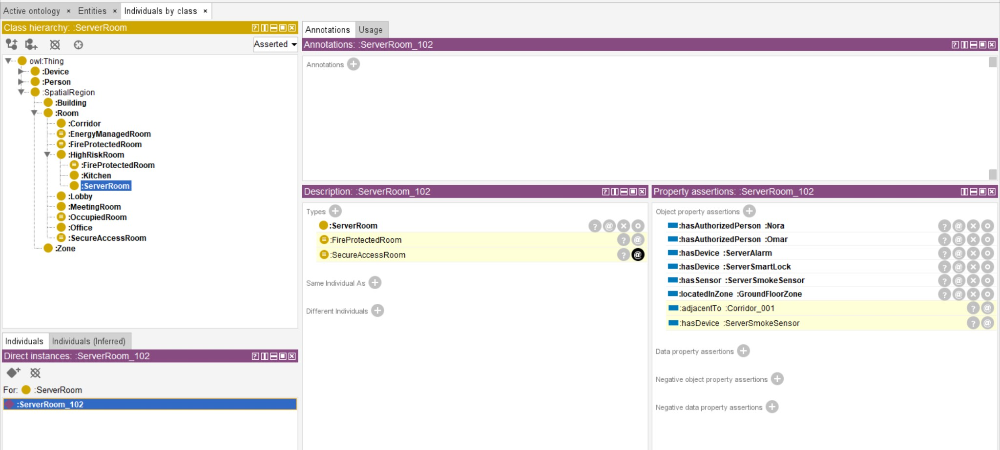

# AI-Based Smart Building Ontology and Reasoning

This project models a smart building in OWL 2. It represents rooms, zones,
devices, and people, and uses the HermiT reasoner in Protégé to infer room
classifications from the facts recorded in the ontology.

## What the ontology models

- Buildings, zones, and rooms connected through spatial containment and adjacency
- Sensors, alarms, HVAC units, and smart locks associated with rooms
- OWL class definitions for fire protection, occupancy, secure access, and
  energy management

## Reasoning walkthrough

The ontology explicitly classifies `ServerRoom_102` as a `ServerRoom`. It also
records that the room has a smart lock and that two staff members, `Nora` and
`Omar`, are authorized to access it.

The `SecureAccessRoom` class is defined by this OWL expression:

```text
Room
and (hasDevice some SmartLock)
and (hasAuthorizedPerson min 2 StaffMember)
```

The ontology explicitly declares `Nora` and `Omar` to be different individuals.
Together with the smart lock and the two authorization facts, this lets HermiT
infer that `ServerRoom_102` is a `SecureAccessRoom`. HermiT also infers
`FireProtectedRoom` because the server room is a high-risk room with a smoke
sensor and an alarm.



## Reproduce the inference

1. Open [smart-building.owl](smart-building.owl) in Protégé Desktop.
2. Select **HermiT** from the **Reasoner** menu and click **Start reasoner**.
3. Open **Window → Tabs → Individuals by class**.
4. In the class hierarchy, expand `SpatialRegion → Room → HighRiskRoom` and
   select `ServerRoom`. Under **Direct instances**, select `ServerRoom_102`.
5. In **Description → Types**, look for `SecureAccessRoom` and
   `FireProtectedRoom`. Enable **Show Inferences** if needed.